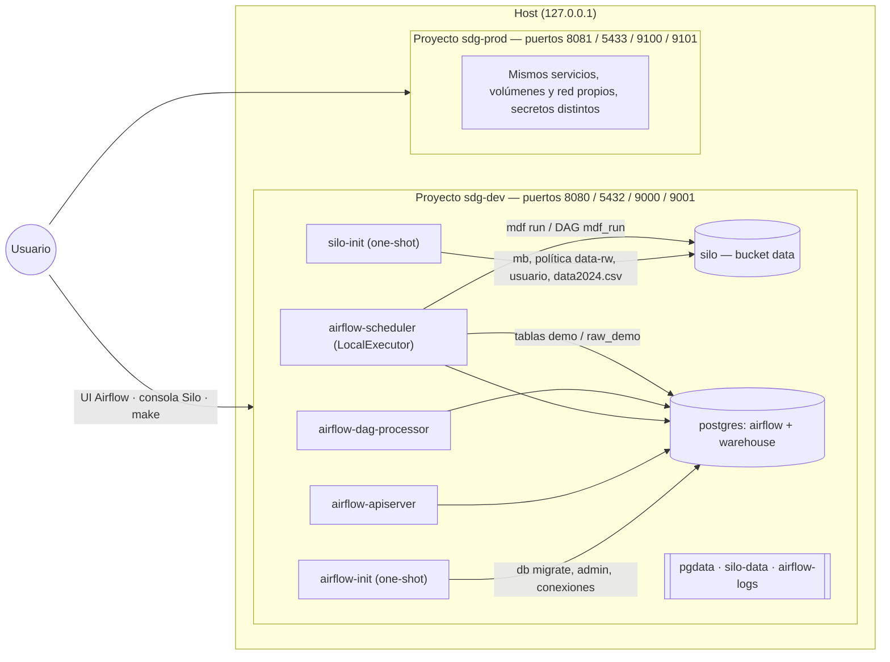
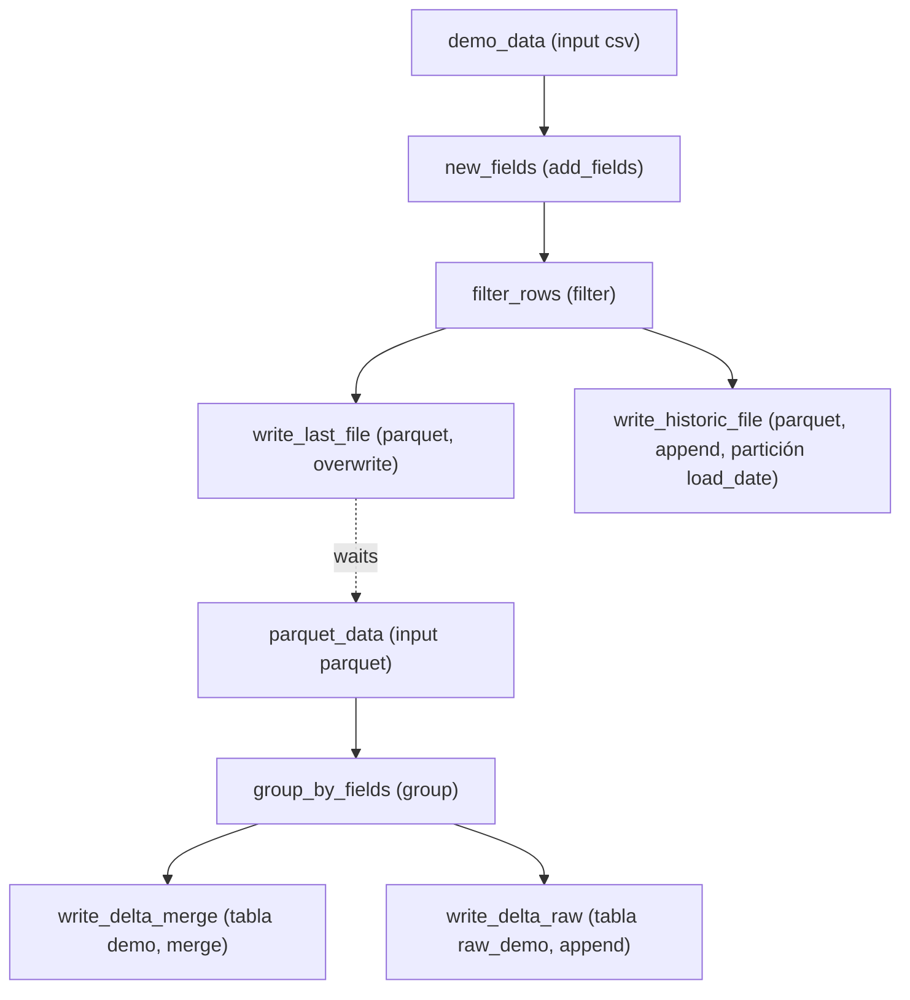
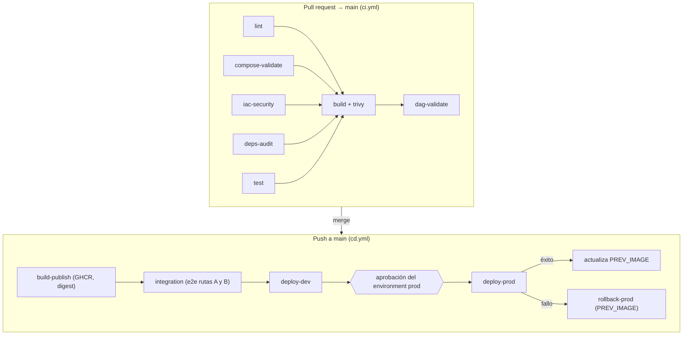
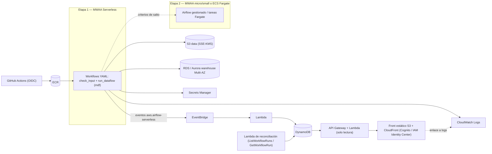

# Diagramas

## 1. Arquitectura local

Cada entorno es un proyecto Compose independiente (`sdg-dev`, `sdg-prod`): red, volúmenes, puertos y credenciales propios. El código y el `compose.yaml` son los mismos.

## 2. Grafo del dataflow `access-test`

## 3. CI/CD

## 4. Propuesta AWS por etapas

